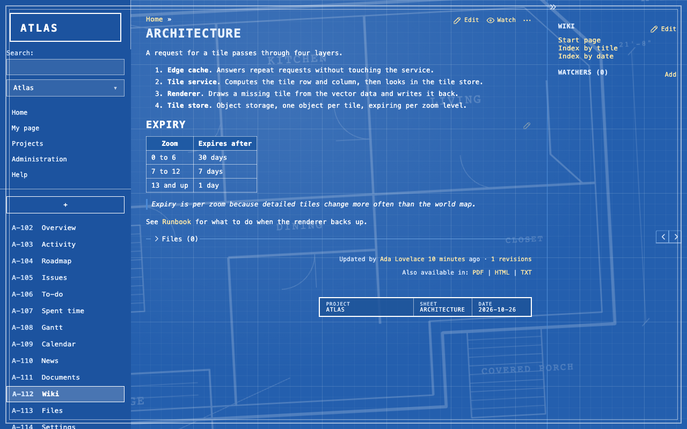

# Rubylode Azurite for Redmine

A blueprint theme for Redmine 7 and up: a blue sheet with white drawing lines, a grid and a title block.

It is CSS plus one small script (`javascripts/theme.js`). It needs no plugin and changes nothing in Redmine. The script only reads the page: it puts a ring round issue numbers, adds initials next to assignees, adds a title block at the foot of the page and builds a row of view tabs. Without the script you get plainer lists. The light set is the main one, and a dark set follows your system setting (see [Dark mode](#dark-mode)).


| | |
|---|---|
|  |  |
|  |  |
|  |  |

Dark mode:


| | |
|---|---|
|  |  |

## Contents

- [Install](#install)
- [What is covered](#what-is-covered)
- [Dark mode](#dark-mode)
- [Compatibility](#compatibility)
- [Development](#development)
- [Checks and releases](#checks-and-releases)
- [License](#license)

## Install

1. Download the zip attached to the latest release (the Releases page of this repository) and unzip it inside the `themes` folder of your Redmine, so that `themes/azurite/stylesheets/application.css` exists. Or copy the `azurite` folder from the source tree.
2. Restart Redmine.
3. In Administration, Settings, Display, choose **Azurite** as the theme and save.

To go back, choose another theme on the same page. The only thing written to the database is that setting.

## What is covered

Styled by hand, in light and dark: the header and menus, the sidebar, the issue list, the issue page with its history, the new and edit forms, buttons, flash messages, tables, tabs, the context menu and the login page.

The other pages (Gantt, calendar, wiki, administration) take their colours from the same variables, and I fix them as I find problems.

## Dark mode

Dark mode follows your system setting. To keep the theme light, delete the `@media (prefers-color-scheme: dark)` block at the end of `azurite/stylesheets/application.css`. Every dark rule is in that block.

## Compatibility

Redmine 7.0 and newer, tested on 7.0.2 and the 7.0 line. Older versions are not supported.

## Development

You need Docker, Ruby, Node and Chrome.

```
npm install
ruby bin/demo up        # a throwaway Redmine with demo data at http://localhost:3106 (admin / admin)
npm run check           # loads every page in light and dark, at desktop and phone width
npm run screenshots     # docs/screenshots
npm run record          # docs/demo, a GIF of a walk through the pages
ruby bin/demo reset     # wipe the demo
```

If a copy of the Rubylode to-do plugin sits next to this repository (`../redmine-rubylode-todo`, or set `TODO_PLUGIN_PATH`), the demo mounts it and the check, screenshots and recording include its page. Without it they skip that page.

The check fails on console errors, failed requests, sideways scrolling and text below WCAG AA contrast. `REDMINE_TAG=7.0 ruby bin/demo up` runs it against the other Redmine version. After you change the stylesheet, run `ruby bin/demo restart` and reload, because Redmine caches theme files until it restarts.

## Checks and releases

Every push starts a real Redmine from its Docker image (7.0.2 and 7.0), loads every page of the theme in light and dark at desktop and phone width, and fails on console errors, failed requests, sideways scrolling and low text contrast.

- GitHub: `.github/workflows/check.yml` runs on every push and on pull requests.
- Gitea: `.gitea/workflows/check.yml` runs on pushes to `main` only. Its runner works on the host with Docker access, so it should only run code that is already merged.

A tag such as `v1.0.0` runs the same check, builds `<name>-<version>.zip` with the theme folder in it, and attaches it to a release with the matching section of `CHANGELOG.md` as the notes (`release.yml` in the same folders). The tag needs a section for that version in the changelog.

## License

GPL version 2 or later, the same as Redmine. See `LICENSE`. Copyright (C) 2026  Nick Gorbikoff.

No warranty, as the GPL says. Try the theme on a copy of your tracker before the real one.

Pull Requests are welcome!
